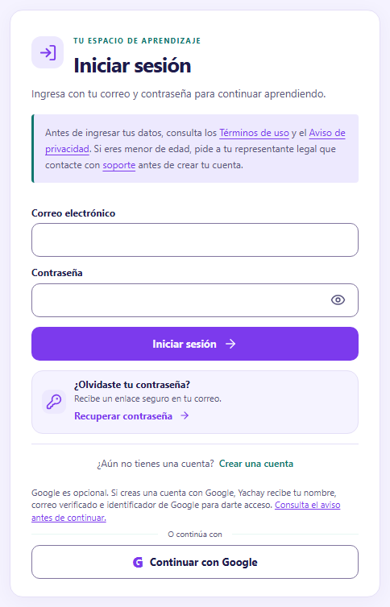
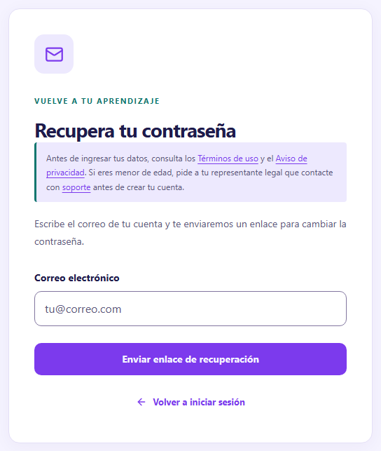
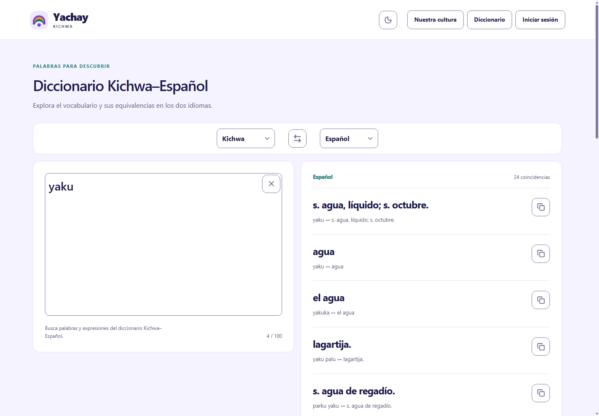
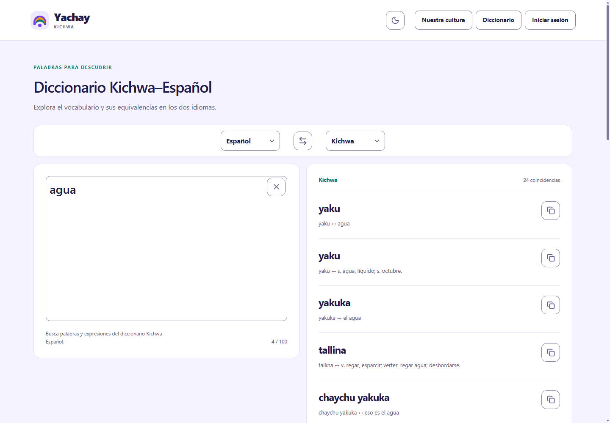

# 4.4 Sprint 3: Desarrollo del sistema

## 4.4.1 Objetivo del Sprint 3

Desarrollar e integrar los componentes de Yachay para administrar y consultar contenidos de aprendizaje del kichwa, autenticar a los usuarios según su perfil, resolver ejercicios con retroalimentación, procesar evaluaciones y consultar el progreso y el diccionario, mediante las funcionalidades implementadas en React, Laravel y PostgreSQL. El alcance comprende el contenido publicado del nivel básico y las secciones disponibles del nivel intermedio, diferenciando la estructura educativa registrada, el material de consulta y las prácticas evaluables.

## 4.4.2 Actividades principales

- Organizar el frontend y el backend e integrar sus servicios mediante la API.
- Implementar las migraciones, los modelos y las restricciones de integridad del esquema educativo.
- Incorporar el registro, el acceso local, la recuperación de contraseña y los controles por perfil y estado de cuenta.
- Desarrollar la administración, publicación y consulta de niveles, módulos, unidades, temas y actividades.
- Construir las interacciones de práctica, la corrección en el servidor y la retroalimentación por respuesta.
- Implementar los intentos de evaluación, las calificaciones y los requisitos de habilitación.
- Integrar el progreso, las recompensas, el diccionario y la consulta administrativa de estudiantes.
- Contrastar las decisiones de diseño con el código y ejecutar comprobaciones técnicas de alcance definido.

## 4.4.3 Sprint Backlog

La Tabla 24 conserva las estimaciones documentadas en el Sprint Backlog de la tesis. Estas expresan esfuerzo previsto por tarea; no representan duración real, fechas de ejecución ni un calendario acumulado. Los responsables de las tareas son Edgar Punina y Edison Aucatoma. Los estados se establecen a partir de la implementación revisada y de las comprobaciones registradas el 23 de octubre de 2026.

Tabla 24. Sprint Backlog del Sprint 3.

| ID | Tarea | Estimación | Responsables | Estado |
| --- | --- | --- | --- | --- |
| T-01 | Configurar el entorno de desarrollo e implementar la estructura de datos, las migraciones, las relaciones y las restricciones. | 3 días | Edgar Punina y Edison Aucatoma | Implementado; esquema y metadatos consultados. |
| T-02 | Desarrollar el registro, la autenticación, la recuperación de contraseña y los controles de acceso por perfil. | 5 días | Edgar Punina y Edison Aucatoma | Implementado; pruebas aisladas del frontend aprobadas. Aceptación parcial de HU-01 y HU-02. |
| T-03 | Implementar la gestión administrativa de contenidos y la navegación del estudiante por niveles, módulos y unidades. | 6 días | Edgar Punina y Edison Aucatoma | Implementado; catálogo consultado. Contenido intermedio parcialmente desarrollado. |
| T-04 | Desarrollar los ejercicios interactivos, la comprobación de respuestas, el almacenamiento de resultados y la retroalimentación. | 6 días | Edgar Punina y Edison Aucatoma | Implementado; pruebas aisladas aprobadas. Recorrido persistente pendiente de comprobación. |
| T-05 | Implementar las evaluaciones, la gestión de intentos y el cálculo automático de calificaciones. | 6 días | Edgar Punina y Edison Aucatoma | Implementado; banco publicado y elegibilidad consultados. Envío integral pendiente. |
| T-06 | Desarrollar el seguimiento del progreso, el diccionario y la consulta administrativa de estudiantes. | 5 días | Edgar Punina y Edison Aucatoma | Implementado; búsqueda del diccionario observada. Progreso y administración sin comprobación integral. |
| T-07 | Integrar el frontend, el backend y la base de datos, y realizar las comprobaciones técnicas iniciales. | 4 días | Edgar Punina y Edison Aucatoma | Parcialmente comprobado: tipos, pruebas aisladas e integración pública del diccionario. |
| T-08 | Integrar las colaboraciones previstas en los patrones GoF del Sprint 2 y comprobar su correspondencia con los componentes desarrollados. | 3 días | Edgar Punina y Edison Aucatoma | Correspondencia verificada en código; cadena administrativa resuelta en ejecución. |

En esta tabla, «implementado» indica que existen los componentes que atienden la tarea; «consultado» identifica resultados obtenidos mediante lectura de la base o resolución del contenedor; «pruebas aisladas aprobadas» corresponde a los casos automatizados ejecutados; y «observado» identifica una operación realizada en la interfaz real. Ninguno de estos estados equivale por sí solo a la validación integral con usuarios del Sprint 4.

## 4.4.4 Resultados del Sprint 3

El incremento revisado corresponde al commit `df7aed7d6968f0e49ff52932e097b40bf7879749`. Al iniciar la revisión, Git no registró cambios locales. La revisión permitió identificar los componentes implementados, el estado de publicación del catálogo y los resultados de las comprobaciones técnicas. La exposición siguiente distingue estos niveles de evidencia y conserva la relación con los requerimientos RF-01 a RF-16 y las historias HU-01 a HU-16 del Sprint 1.

### 4.4.4.1 Organización del código fuente

El código se distribuye en dos aplicaciones. `frontend/` contiene la interfaz React con TypeScript: `src/js/pages/` reúne las pantallas de autenticación, administración y aprendizaje; `components/` contiene las interacciones reutilizables; `context/AuthContext.tsx` administra el estado de acceso; `services/` centraliza las solicitudes, la sesión de pestaña y el estado de las prácticas; y `hooks/useApi.ts` conecta las consultas con TanStack Query. `router.tsx` declara las rutas de navegación y sus controles de presentación. Los estilos se encuentran en `src/css/` y los recursos públicos, en `public/`.

En `backend/`, las rutas de la API se encuentran en `routes/api.php` y las redirecciones web de Google y verificación de correo, en `routes/web.php`. Los controladores de `app/Http/Controllers/Api/` reciben las solicitudes; `Requests/` define validaciones específicas; `Middleware/` reúne controles de cuenta, rol y sesión; y `Services/` concentra las reglas de publicación, corrección, progreso y evaluaciones. Los modelos se ubican en `app/Models/`; las migraciones y semillas, en `database/`; y las lecciones estructuradas, en `resources/lessons/`. Las suites automatizadas están separadas en `frontend/tests/` y `backend/tests/`.

Las versiones consultadas en las dependencias instaladas fueron React y React DOM 19.3.0, React Router DOM 7.18.4, TypeScript 7.0.2, Vite 8.3.1, Tailwind CSS 4.3.3 y TanStack Query 5.104.1. En el backend se identificaron Laravel 13.34.0, Sanctum 4.3.3, Socialite 5.31.0 y PHPUnit 12.5.37. Las comprobaciones se ejecutaron con Node.js 24.16.0 y PHP 8.4.22; la conexión consultada informó PostgreSQL 18.6. Estos valores corresponden a la versión revisada y se diferencian de los rangos de compatibilidad declarados en `package.json` y `composer.json`.

Los directorios `documentacion-base/` y el archivo `backend/database/schema/postgresql.sql` reúnen antecedentes del esquema. La estructura vigente se determina a partir de las migraciones aplicadas y del esquema consultado. Asimismo, el README conserva descripciones de una versión anterior de la Unidad 1; la disponibilidad actual se presenta en el apartado 4.4.4.4.

### 4.4.4.2 Implementación de la base de datos

La consulta de metadatos identificó 41 migraciones aplicadas, 38 tablas y cinco vistas del esquema público. El núcleo utilizado por la API se organiza alrededor de `usuarios`, `niveles`, `modulos`, `unidades`, `temas`, `actividades`, `evaluaciones`, `preguntas`, `intentos_evaluacion`, sus respuestas, `usuarios_niveles`, `progreso`, `recompensas` y `diccionario`. También existen tablas de infraestructura y un conjunto paralelo con nombres en inglés, creado por una migración anterior. La presencia de estas tablas no acredita su utilización en el recorrido principal: el proveedor de autenticación apunta a `Usuario` y `KichwaResource::MODELS` selecciona los modelos del esquema en español.

La jerarquía educativa se relaciona mediante claves foráneas: un módulo pertenece a un nivel; una unidad, a un módulo; y un tema, a una unidad. Las actividades pertenecen a una unidad y pueden vincularse a un tema. `usuarios_niveles` relaciona estudiantes y niveles; `progreso` identifica la unidad iniciada por cada estudiante. Los intentos relacionan al estudiante con una evaluación y sus respuestas vinculan el intento, la evaluación y la pregunta correspondiente.

El fragmento F01 muestra la creación de `unidades`. Resuelve la identificación de cada unidad y su pertenencia al módulo, lo que sustenta RF-04 a RF-06 y RF-13, correspondientes a HU-04 a HU-06 y HU-13.

Fragmento F01. `backend/database/migrations/2026_09_30_000004_create_unidades_table.php`, up(), líneas 14–21.

```sql
CREATE TABLE unidades (
    id_unidad bigint GENERATED BY DEFAULT AS IDENTITY PRIMARY KEY,
    id_modulo bigint NOT NULL REFERENCES modulos (id_modulo) ON DELETE RESTRICT,
    titulo_unidad varchar(180) NOT NULL,
    objetivo_unidad text NOT NULL,
    orden_unidad integer NOT NULL CHECK (orden_unidad > 0),
    UNIQUE (id_modulo, orden_unidad)
);
```

La clave primaria se genera como identidad. La referencia a `modulos` impide eliminar un padre con unidades dependientes mediante `ON DELETE RESTRICT`; el orden debe ser positivo y no repetirse dentro del módulo. Las migraciones posteriores añaden publicación y configuración. El modelo `Unidad` declara la tabla, su clave y las conversiones de esos campos; las consultas de la jerarquía se construyen mediante claves y uniones explícitas. No se identificaron métodos `belongsTo` o `hasMany` en los modelos educativos principales, por lo que estas relaciones no se atribuyen a asociaciones Eloquent inexistentes.

En las cuentas, la base establece unicidad de correo y cédula, normalización del correo y valores admitidos para rol y estado. La migración de autenticación permite una contraseña nula para cuentas creadas mediante Google. Los intentos y respuestas incorporan restricciones de identidad, pertenencia y estado. La migración de evaluaciones de módulo añade `id_modulo` y una restricción que diferencia evaluaciones de unidad, diagnósticas y de módulo; además, un índice parcial admite una sola evaluación de módulo publicada por módulo.

El esquema utiliza lógica de PostgreSQL además de las validaciones de Laravel. Se identificaron trece funciones propias con prefijo `kichwa_`, entre ellas `kichwa_validar_estudiante`, `kichwa_validar_intento`, `kichwa_validar_respuesta_evaluacion`, `kichwa_proteger_actividad`, `kichwa_proteger_pregunta`, `kichwa_proteger_evaluacion`, `kichwa_registrar_practica` y `kichwa_normalizar`. Las funciones de integridad se ejecutan mediante triggers; no se identificaron procedimientos propios con ese prefijo. La consulta comprobó su existencia, sin ejecutar inserciones o eliminaciones para probar cada restricción.

Los mecanismos de protección conservan las respuestas y el historial. Cuando una actividad o evaluación ya fue utilizada, los cambios sustantivos se restringen y la administración ofrece crear otra versión. Las versiones posteriores de las funciones permiten cambios específicos de orden o publicación sin reescribir las respuestas. Las recompensas registradas son inmutables y su origen debe corresponder al mismo estudiante.

Las vistas `v_evaluaciones` y `v_intentos_evaluacion` agregan puntajes máximos y resultados de intentos. `v_progreso`, `v_progreso_modulos` y `v_progreso_niveles` calculan indicadores de avance. Sus definiciones evolucionan mediante migraciones; en particular, el cálculo de práctica reconoce el linaje de una actividad para conservar aciertos entre versiones. El diccionario utiliza `pg_trgm`, índices GIN y la función SQL `kichwa_normalizar`, invocados por la búsqueda implementada en Laravel.

### 4.4.4.3 Autenticación y control de acceso

El registro valida nombres, apellidos, correo, contraseña y confirmación. La cédula es opcional y, cuando se proporciona, se comprueban su formato, provincia y dígito verificador. `RegisterRequest` prohíbe que el solicitante asigne rol o estado. `AuthController::register()` crea la cuenta y su asociación inicial con Básico dentro de una transacción; el rol estudiante se obtiene del valor predeterminado del esquema. El modelo `Usuario` convierte la contraseña mediante el cast `hashed` y excluye contraseña, identificador de Google y token de recuerdo de su serialización habitual.

El acceso local utiliza correo y contraseña. El fragmento F02 muestra la normalización del identificador, la limitación de intentos fallidos y la comprobación del hash. Atiende RF-01/HU-01 en la validación de acceso; existe una diferencia respecto del criterio original de autenticación mediante cédula.

Fragmento F02. `backend/app/Http/Controllers/Api/AuthController.php`, login(), líneas 50–62.

```php
$identifier = mb_strtolower(trim($data['identifier']));
$key = 'login:'.hash('sha256', $identifier.'|'.$request->ip());
if (RateLimiter::tooManyAttempts($key, 5)) {
    return response()->json(['message' => 'Demasiados intentos. Espera unos minutos.'], 429);
}
$user = Usuario::where('correo_usuario', $identifier)->first();
if (! $user || $user->estado_usuario !== 'activo' || ! $user->contrasena_usuario || ! Hash::check($data['password'], $user->contrasena_usuario)) {
    RateLimiter::hit($key, 300);
    throw ValidationException::withMessages(['identifier' => 'Correo o contraseña incorrectos, o cuenta bloqueada.']);
}
RateLimiter::clear($key);

return $this->authenticate($request, $user);
```

El controlador consulta `correo_usuario`, requiere una cuenta activa y utiliza `Hash::check()`. Después de cinco fallos por combinación de identificador y dirección IP, aplica un periodo de espera de 300 segundos; la ruta incorpora además su propio límite de solicitudes. Al autenticar una solicitud con sesión, regenera su identificador y vincula la credencial de la pestaña. Cuando la solicitud no dispone de sesión, el controlador incluye una alternativa mediante token de Sanctum; el cliente web revisado utiliza cookies y la cabecera `X-Tab-Session`.

`AutenticacionPestana` y el middleware `SesionPestana` mantienen la relación entre la credencial de cada pestaña, el usuario y la huella de su contraseña. `AuthContext.tsx` consulta la cuenta cuando corresponde, limpia el estado ante una respuesta de sesión vencida y aplica cierre por inactividad de treinta minutos. El cierre de sesión en el servidor revoca los tokens de la cuenta y la vinculación de la pestaña, cierra el guard y regenera los identificadores de sesión y CSRF. Este comportamiento implementa RF-16/HU-16.

Las rutas protegidas se agrupan bajo `auth:sanctum` y `active`. Las operaciones administrativas añaden `role:admin`; las del estudiante, `role:student`. F03 corresponde a `RequireRole::handle()` y materializa la autorización por perfil de RF-12 a RF-15 y HU-12 a HU-15.

Fragmento F03. `backend/app/Http/Middleware/RequireRole.php`, handle(), líneas 11–17.

```php
public function handle(Request $request, Closure $next, string $role): Response
{
    $expected = $role === 'admin' ? 'administrador' : 'estudiante';
    abort_unless($request->user()?->rol_usuario === $expected, 403, 'No tienes permiso para esta acción.');

    return $next($request);
}
```

El middleware traduce el código de ruta al rol almacenado y responde con 403 cuando no coincide. `CuentaActiva` interrumpe el acceso de cuentas bloqueadas y restringe las cuentas con cambio inicial de contraseña pendiente a las operaciones permitidas. `Protected`, en `router.tsx`, realiza redirecciones de interfaz; la autorización de las operaciones permanece en Laravel. La verificación de correo está implementada, pero no aparece como requisito general `verified` en el grupo principal de la API.

La recuperación se implementa mediante el broker de contraseñas de Laravel. `forgotPassword()` normaliza el correo, solicita el enlace únicamente para cuentas activas y devuelve un mensaje que no confirma la existencia de la cuenta. `resetPassword()` valida token y confirmación, utiliza una transacción y revoca sesiones y tokens tras el cambio. `config/auth.php` establece una vigencia de sesenta minutos. La configuración y los callbacks de `AppServiceProvider` construyen el enlace del frontend y el mensaje en español. La existencia de estos componentes no equivale a una entrega de correo comprobada en un buzón.

El acceso con Google se integra mediante Socialite. `prepare()`, `redirect()` y `callback()` relacionan el inicio del proceso con la pestaña; Socialite comprueba `state`. El callback exige un correo verificado, distingue ingreso y vinculación y rechaza la asociación automática de una cuenta local existente por coincidencia de correo. La vinculación requiere una sesión válida y el mismo correo; las cuentas nuevas reciben el perfil estudiante. Se observó el botón habilitado por la configuración pública, sin realizar el intercambio OAuth con Google.

La implementación del registro y del acceso es parcial respecto de la aceptación literal de HU-01 y HU-02: no se implementa ingreso por cédula y el registro no la exige. La recuperación y Google amplían las operaciones descritas en el Sprint 1; no se les asigna una historia adicional que no conste en ese apartado.



La Figura 4.4-1 evidencia la interfaz de acceso por correo y las opciones de recuperación y Google. La captura corresponde a la presentación del formulario; no acredita una autenticación completada.


La Figura 4.4-2 muestra los campos de registro y la identificación opcional. Esta presentación coincide con las reglas vigentes de `RegisterRequest` y permite distinguirlas de los criterios iniciales de HU-02.



La Figura 4.4-3 evidencia la disponibilidad de la solicitud de recuperación. El envío y el uso de un enlace no forman parte de la observación registrada.

### 4.4.4.4 Gestión y consulta de contenidos educativos

`KichwaAdminController` implementa consulta, creación, actualización, eliminación, ordenamiento y versionado de niveles, módulos, unidades, temas, actividades, evaluaciones y preguntas. `SaveKichwaContentRequest` valida los datos y exige perfil administrativo. `KichwaResource` relaciona los campos de la API con las columnas del esquema. Los módulos, unidades y temas nuevos se crean en borrador según los valores predeterminados de publicación; la creación de un registro no implica que sea accesible al estudiante.

La consulta del catálogo requiere la publicación de los antecesores. F04 corresponde a `KichwaCatalogController::publishedUnit()` y atiende RF-03 a RF-06/HU-03 a HU-06, así como la visibilidad definida en RF-13/HU-13.

Fragmento F04. `backend/app/Http/Controllers/Api/KichwaCatalogController.php`, publishedUnit(), líneas 30–35.

```php
public static function publishedUnit(int $id): Unidad
{
    return Unidad::select('unidades.*', 'modulos.id_nivel', 'modulos.nombre_modulo', 'niveles.nombre_nivel')->join('modulos', 'modulos.id_modulo', '=', 'unidades.id_modulo')
        ->join('niveles', 'niveles.id_nivel', '=', 'modulos.id_nivel')->where('niveles.publicado', true)
        ->where('modulos.publicado', true)->where('unidades.publicado', true)->where('unidades.id_unidad', $id)->firstOrFail();
}
```

La consulta une unidad, módulo y nivel, exige los tres indicadores de publicación y devuelve 404 cuando no encuentra una unidad accesible. `publishedEvaluation()` extiende la regla a evaluaciones y temas. `PublicacionContenido::exercises()` filtra las prácticas publicadas, distingue los modos clásico, guiado y secuencial y selecciona la versión vigente por linaje. La administración invalida la versión de caché del catálogo después de los cambios; las lecturas compartidas se conservan durante 300 segundos bajo una clave versionada.

La publicación de ejercicios y preguntas requiere más que activar una casilla. F05 muestra la validación que utiliza `EstadoContenido::assertReady()` antes de admitir un reactivo listo para uso, en relación con RF-14 y RF-15/HU-14 y HU-15.

Fragmento F05. `backend/app/Services/EstadoContenido.php`, assertReady(), líneas 50–57.

```php
public static function assertReady(array $exercise): void
{
    ContratoEjercicio::validate($exercise);
    $errors = self::requirements($exercise);
    if ($errors !== []) {
        throw ValidationException::withMessages(['publication' => $errors]);
    }
}
```

El contrato verifica tipo, identificadores, referencias, solución y configuración. Los requisitos adicionales comprueban la marca de revisión en los reactivos gestionados, la presencia de audio obligatorio y las imágenes requeridas. Para publicar una evaluación gestionada se exige un banco suficiente de preguntas publicadas y elegibles; las evaluaciones secuenciales tienen condiciones específicas. Estas marcas técnicas no sustituyen una constancia de validación lingüística por el docente.

La consulta del 23 de octubre de 2026 identificó cuatro módulos y dieciocho unidades con su jerarquía publicada. Su contenido efectivo se distribuye así:

- Básico, módulo 1 «Primeros contactos con el kichwa»: «Conociendo el Kichwa», 6 actividades; «Saludos y conversación», 30; «Pronombres personales», 6; «Números y cantidades», 7; y «Días, meses y calendario», 6. Las cinco unidades utilizan modo guiado y suman 55 prácticas visibles. La prueba final del módulo tiene 15 preguntas publicadas y elegibles.
- Básico, módulo 2 «Vocabulario y gramática básica»: «Animales y colores», 15 actividades; «Partes del cuerpo», 6; «Naturaleza y entorno cercano», 3; y «Verbos frecuentes y raíz verbal», 4. Las cuatro unidades utilizan modo guiado y suman 28 prácticas visibles. No se identificó una evaluación de módulo publicada para este grupo.
- Intermedio, módulo 1 «Conjugación y estudio de los morfemas 1 y 2»: existen cinco unidades visibles sobre conjugación, morfemas básicos, morfemas medios, adverbios y modalidades de la oración. No se identificaron temas ni actividades publicados en ellas. Su estructura está registrada y el contenido de aprendizaje continúa en preparación.
- Intermedio, módulo 2 «Morfemas avanzados y construcción escrita»: existen cuatro unidades guiadas sobre ocupaciones, orden y parentesco; pasado y futuro con `-rka` y `-sha`; análisis de morfemas verbales; y conversaciones cortas. Cada unidad tiene un tema publicado y una presentación específica alimentada por recursos JSON. No se identificaron actividades publicadas ni evaluaciones publicadas para estas unidades; su alcance es introductorio y de consulta.

En total, el catálogo consultado contiene 83 prácticas visibles, todas del nivel básico. Intermedio tiene material introductorio parcialmente implementado y una estructura adicional sin contenido publicado; no constituye un nivel completo de práctica y evaluación. El indicador de disponibilidad de nivel comprueba la existencia de módulos publicados, por lo que puede habilitar la navegación aun cuando determinadas unidades estén vacías.

Las evaluaciones anteriores de la Unidad 1 permanecen registradas, pero están ocultas. La unidad vigente utiliza seis prácticas guiadas; no se presenta como disponible la secuencia anterior de siete actividades y una prueba de seis preguntas descrita en antecedentes. Los seeders vigentes incluyen las unidades guiadas de Básico y las cuatro introducciones de Intermedio; la disponibilidad descrita procede de la base consultada, no de suponer que una semilla se ejecutó por existir en el repositorio.

### 4.4.4.5 Ejercicios interactivos y retroalimentación

El contrato de ejercicios admite selección múltiple, completar, relacionar, arrastrar y ordenar. `ExerciseCard`, `GuidedUnit` y los paneles especializados presentan estas interacciones con apoyos de audio o imagen cuando la configuración los requiere. El frontend comprueba que la interacción esté suficientemente completa antes de enviarla; el servidor valida y califica los datos recibidos.

F06 corresponde a la rama de selección de `ContratoEjercicio::grade()`. Atiende RF-07/HU-07 y la identificación de aciertos prevista en RF-09/HU-09.

Fragmento F06. `backend/app/Services/ContratoEjercicio.php`, grade(), rama seleccion_multiple, líneas 419–430.

```php
if ($exercise['type'] === 'seleccion_multiple') {
    self::keys($answer, ['seleccion']);
    self::selection($answer['seleccion'] ?? null, array_column($exercise['elements'], 'id'));
    if (count($answer['seleccion']) > ($exercise['config']['max_selections'] ?? 50)) {
        self::fail('Has superado el límite de selecciones.', 'answer');
    }
    if (($exercise['config']['exact_selections'] ?? false) && count($answer['seleccion']) !== ($exercise['config']['max_selections'] ?? 50)) {
        self::fail('Selecciona exactamente la cantidad indicada.', 'answer');
    }

    return self::sameKeys($answer['seleccion'], $exercise['solution']['seleccion']);
}
```

La corrección rechaza claves inesperadas e identificadores ajenos al ejercicio, comprueba selecciones repetidas y controla el máximo permitido. Cuando se exige una cantidad exacta, también valida ese requisito. El resultado compara el conjunto seleccionado con la solución almacenada; marcar solamente parte de las opciones correctas no convierte toda la actividad en correcta.

En completar, el contrato exige responder todos los espacios y compara cada respuesta con sus variantes admitidas. Normaliza Unicode, espacios y mayúsculas; la eliminación de acentos depende de `ignore_accents` y conserva la distinción entre «n» y «ñ». En ordenar compara el texto de la secuencia, lo que admite letras repetidas intercambiables. Relacionar y arrastrar validan los orígenes y destinos y comparan las parejas esperadas. Estas alternativas se resuelven mediante ramas del contrato; no se presentan como clases Strategy propias.

F07 muestra el núcleo de persistencia de `KichwaSubmissionController::activity()`. Relaciona la corrección con la respuesta del estudiante y con RF-07 y RF-09/HU-07 y HU-09.

Fragmento F07. `backend/app/Http/Controllers/Api/KichwaSubmissionController.php`, activity(), líneas 86–96.

```php
$content = KichwaResource::present('exercises', $record, true);
EstadoContenido::assertReady($content);
$correct = ContratoEjercicio::grade($content, $data['answer']);
$feedback = ContratoEjercicio::feedback($content, $correct);
$answer = RespuestaActividad::create([
    'id_usuario' => $request->user()->id_usuario, 'id_actividad' => $exercise,
    'respuesta_actividad' => $data['answer'], 'acierto_actividad' => $correct,
    'retroalimentacion_actividad' => $feedback, 'id_sesion_practica' => $data['practice_attempt_id'] ?? null, 'clave_envio' => $data['submission_id'] ?? null]);

return ['response_id' => $answer->id_respuesta_actividad, 'is_correct' => $correct, 'feedback' => $feedback, 'highlight' => $record->configuracion['reveal_highlight'] ?? null]
    + DominioLecciones::rewardActivity($record, $answer) + ContratoEjercicio::itemResults($content, $data['answer']);
```

Antes de este bloque, el método comprueba la publicación de la jerarquía y del tema, valida los identificadores UUID de práctica y envío y bloquea los registros necesarios dentro de una transacción. Una clave de envío previamente registrada devuelve el resultado existente cuando coinciden usuario, actividad, sesión y respuesta; si la misma clave corresponde a otros datos, responde con 409. Una nueva sesión de práctica puede generar nuevas recompensas según sus propias claves; la idempotencia no equivale a prohibir repetir una actividad.

`ContratoEjercicio::feedback()` utiliza el texto configurado para acierto o error y añade la explicación disponible; si no existe texto específico, emplea un mensaje general. `itemResults()` desglosa el resultado por elemento y el frontend lo representa en las opciones, espacios, posiciones o parejas correspondientes. El cálculo del acierto total se distingue de la retroalimentación individual: una actividad puede contener respuestas parciales correctas y seguir siendo incorrecta en conjunto.

La respuesta pública no incluye por defecto el campo de solución ni todos los mensajes de configuración. Por ello, la retroalimentación implementada cumple la identificación de aciertos y errores, pero no evidencia que todas las modalidades revelen la respuesta completa tras un fallo, como expresa uno de los criterios de HU-09. La explicación depende del contenido configurado. Las pruebas aisladas ejecutadas comprobaron casos de interacción y normalización; el recorrido autenticado con persistencia requiere una comprobación específica.

### 4.4.4.6 Evaluaciones y cálculo de calificaciones

Las evaluaciones se administran junto con sus preguntas. El inicio de un intento verifica la publicación, los requisitos de desbloqueo y las preguntas elegibles. `KichwaSubmissionController::start()` bloquea los registros del estudiante y de la evaluación dentro de una transacción, reutiliza un intento abierto y, cuando crea otro, asigna un número correlativo. En evaluaciones gestionadas selecciona la cantidad configurada de preguntas, por orden fijo o mediante selección aleatoria, y conserva sus identificadores en `preguntas_seleccionadas`.

Las rutas de reanudación y borrador recuperan el intento del propio estudiante y permiten guardar respuestas mientras se encuentra en curso. Las operaciones de envío comprueban que se responda una vez cada pregunta seleccionada, sin omisiones ni preguntas externas. Las respuestas de un intento cerrado no se modifican; un reenvío de un intento finalizado con resultado devuelve el resultado almacenado. La implementación atiende RF-08/HU-08 y RF-15/HU-15.

F08 recoge el cálculo y cierre de `KichwaSubmissionController::submit()`.

Fragmento F08. `backend/app/Http/Controllers/Api/KichwaSubmissionController.php`, submit(), líneas 204–212.

```php
$maximum = (float) $questions->sum('puntaje_pregunta');
$obtained = (float) RespuestaEvaluacion::where('id_intento', $attempt->id_intento)->sum('puntaje_respuesta_evaluacion');
$score = round(100 * $obtained / $maximum, 2);
$rewards = DominioLecciones::reward($attempt, EvaluacionKichwa::findOrFail($evaluation), $results, $score);
$passed = ($record->configuracion['sequence_mode'] ?? false) ? count(array_filter($results, fn ($r) => $r['is_correct'])) >= ($record->configuracion['required_correct'] ?? 5) : $score >= ($record->configuracion['pass_percentage'] ?? 80);
$attempt->resultado = ['passed' => $passed] + $rewards + ['attempt_id' => $attempt->id_intento, 'score' => $score, 'puntaje_obtenido' => $obtained, 'puntaje_maximo' => $maximum, 'correct_count' => count(array_filter($results, fn ($r) => $r['is_correct'])), 'total_questions' => count($results), 'results' => $results];
$attempt->estado_intento = 'finalizado';
$attempt->fecha_fin_intento = now();
$attempt->save();
```

Cada pregunta otorga su puntaje completo cuando el contrato la considera correcta y cero cuando es incorrecta. La calificación porcentual se calcula como 100 multiplicado por el puntaje obtenido y dividido por el máximo de las preguntas seleccionadas; el resultado se redondea a dos decimales. El registro conserva aciertos, cantidad de preguntas, puntajes, mensajes y estado de aprobación. La regla general utiliza el porcentaje configurado, con 80 % como valor predeterminado; la alternativa secuencial utiliza el número de aciertos requerido.

La evaluación publicada «Prueba final del módulo 1» tiene quince preguntas elegibles y exige 80 %. Con quince preguntas de igual puntaje, la aprobación requiere al menos doce aciertos. `EvaluacionModulo::status()` verifica la cobertura de las cinco unidades requeridas y que todas sus prácticas visibles estén correctamente realizadas. El umbral y la cantidad proceden de la configuración del banco publicado; no se generalizan a todas las evaluaciones del sistema.

Las evaluaciones secuenciales antiguas de la Unidad 1 requieren seis preguntas y cinco aciertos según `SecuenciaUnidad`, pero están ocultas en el catálogo revisado. No se identificaron diagnósticos publicados ni pruebas finales publicadas para Básico módulo 2 o Intermedio. La funcionalidad de administración y procesamiento existe; la cobertura evaluativa del catálogo es parcial.

La consulta histórica utiliza también `v_intentos_evaluacion`, cuya definición divide el puntaje por el máximo del banco de la evaluación. El controlador de envío divide por las preguntas seleccionadas. En el banco publicado revisado ambas cantidades corresponden a las quince preguntas disponibles; para bancos de mayor tamaño que la selección, la equivalencia entre ambas fuentes requiere una comprobación adicional. Las pruebas unitarias ejecutadas verifican el contrato de corrección, sin acreditar por sí solas el envío completo de una evaluación.

### 4.4.4.7 Progreso, diccionario y administración de estudiantes

El progreso de práctica se obtiene de las actividades visibles y de los aciertos asociados al estudiante. F09 corresponde a `ProgresoAprendizaje::unitActivities()` y sustenta RF-10/HU-10.

Fragmento F09. `backend/app/Services/ProgresoAprendizaje.php`, unitActivities(), líneas 15–28.

```php
public static function unitActivities(int $user): Collection
{
    $activities = PublicacionContenido::exercises()->select('id_unidad')
        ->selectRaw("id_unidad::text || ':' || COALESCE(origen_reactivo,id_actividad::text) as lineage")->get();
    $correct = DB::table('respuestas_actividad as r')->join('actividades as a', 'a.id_actividad', '=', 'r.id_actividad')
        ->where('r.id_usuario', $user)->where('r.acierto_actividad', true)
        ->whereIn(DB::raw("a.id_unidad::text || ':' || COALESCE(a.origen_reactivo,a.id_actividad::text)"), $activities->pluck('lineage'))
        ->selectRaw("a.id_unidad::text || ':' || COALESCE(a.origen_reactivo,a.id_actividad::text) as lineage")->distinct()->pluck('lineage');

    return $activities->groupBy('id_unidad')->map(fn ($items): array => [
        'total' => $items->pluck('lineage')->unique()->count(),
        'correct' => $items->pluck('lineage')->unique()->intersect($correct)->count(),
    ]);
}
```

La consulta identifica cada práctica mediante la unidad y su linaje, compara los aciertos históricos con los linajes vigentes y cuenta una actividad una sola vez. De esta manera, repetir envíos no incrementa la cantidad de actividades distintas completadas y publicar otra versión del mismo linaje no elimina automáticamente el avance reconocido.

`ProgresoAprendizaje::forUser()` calcula el porcentaje de una unidad como actividades correctas dividido por actividades visibles, multiplicado por cien; si no hay actividades, devuelve cero. El porcentaje de un módulo es el promedio de los porcentajes de sus unidades, y el de un nivel es el promedio de sus unidades publicadas. El resumen global utiliza la razón entre actividades correctas y actividades totales. Por tanto, el resumen ponderado por cantidad de actividades puede diferir del promedio por unidades; los indicadores no deben interpretarse como fórmulas idénticas.

La finalización también depende del modo de aprendizaje. En una unidad guiada requiere completar todas sus prácticas; las unidades secuenciales consideran la aprobación correspondiente. Un módulo con prueba final requiere además aprobarla. Una introducción sin actividades conserva cero de progreso de práctica y no se declara completada por abrir sus páginas. `DominioLecciones` agrega XP, medallas, mejores resultados e historial por lección; `KichwaCatalogController::progress()` utiliza el identificador del usuario autenticado para consultar sus datos.

Las recompensas se almacenan en `recompensas`, no se infieren del porcentaje mostrado. La práctica correcta concede diez XP según la clave de recompensa y la sesión de práctica. Las evaluaciones conceden diez XP por pregunta correcta y aplican las recompensas de dominio o cierre que correspondan; aprobar la evaluación de módulo puede conceder cincuenta XP y una medalla. Las claves únicas evitan duplicar una misma concesión, mientras que una nueva sesión de práctica puede acumular XP adicionales. El progreso por actividades distintas se mantiene separado de estos puntos.

El diccionario se consulta en las direcciones kichwa–español y español–kichwa. F10 corresponde a `DiccionarioController::search()` y atiende la búsqueda de RF-11/HU-11.

Fragmento F10. `backend/app/Http/Controllers/Api/DiccionarioController.php`, search(), líneas 18–33.

```php
$data = $request->validate(['q' => ['nullable', 'string', 'max:100'], 'direccion' => ['required', 'in:kichwa-es,es-kichwa'], 'page' => ['sometimes', 'integer', 'min:1']]);
$column = $data['direccion'] === 'kichwa-es' ? 'kichwa' : 'español';
$query = Diccionario::query();
$q = trim($data['q'] ?? '');
if ($q !== '') {
    $literal = str_replace(['\\', '%', '_'], ['\\\\', '\\%', '\\_'], $q);
    $query->whereRaw("public.kichwa_normalizar($column) LIKE '%' || public.kichwa_normalizar(?) || '%'", [$literal])
        ->orderByRaw("CASE WHEN public.kichwa_normalizar(btrim($column)) = public.kichwa_normalizar(?) THEN 0 ELSE 1 END", [$q]);
    if ($data['direccion'] === 'es-kichwa') {
        $this->orderSpanishMeanings($query, $q);
    }
    $query->orderByRaw("public.similarity(public.kichwa_normalizar(btrim($column)), public.kichwa_normalizar(?)) DESC", [$q])
        ->orderByRaw("CASE WHEN public.kichwa_normalizar(btrim($column)) LIKE public.kichwa_normalizar(?) || '%' THEN 0 ELSE 1 END", [$literal])
        ->orderByRaw("char_length(btrim($column)) ASC");
}
$page = $query->orderBy($column)->orderBy('id')->paginate($q === '' ? 5 : 20);
```

La dirección admite únicamente dos valores y determina la columna de consulta. El método limita el texto a cien caracteres, escapa comodines de búsqueda y utiliza parámetros para el término. PostgreSQL normaliza el texto y `similarity()` contribuye al ordenamiento; en la dirección español–kichwa se consideran además acepciones y etiquetas gramaticales. Los resultados se paginan y la interfaz ofrece intercambio de idiomas, mensajes sin coincidencias y copia de equivalencias.

La base consultada contenía 3.776 entradas. El esquema vigente del diccionario tiene únicamente `id`, `kichwa` y `español`: no incluye campos independientes de ejemplo ni un indicador de publicación por entrada. La búsqueda es pública, por lo que el acceso y el modelo de publicación difieren de la precondición de HU-11. La gestión administrativa permite añadir y consultar entradas e importar CSV UTF-8 con dos columnas; el procesamiento valida tamaño y formato y omite duplicados mediante una transacción. No se atribuyen a este recurso operaciones de actualización o eliminación por entrada que no aparecen en sus rutas específicas.



En la Figura 4.4-4 se observan equivalencias devueltas por la API y PostgreSQL. La consulta de «yaku» presentó veinticuatro coincidencias y situó entre los primeros resultados las equivalencias con «agua».



La Figura 4.4-5 muestra el intercambio de dirección y una nueva consulta. El resultado incluye «yaku» y acredita la integración de la búsqueda bidireccional; no constituye una evaluación de la corrección lingüística de todas las entradas.

La consulta de estudiantes se implementa en `KichwaAdminController::students()`: filtra el rol estudiante, admite búsqueda por nombre, correo o cédula y devuelve diez registros por página mediante `perfil()`, que no incorpora la contraseña. `block()` cambia el estado entre activo y bloqueado y, al bloquear, revoca tokens y elimina las sesiones persistidas de la cuenta. La administración dispone también de consulta de resultados de aprendizaje. Estas funciones atienden RF-12/HU-12 y están protegidas por el grupo administrativo; su presencia en código se distingue de una operación administrativa comprobada de extremo a extremo.

### 4.4.4.8 Integración entre frontend y backend

La interfaz realiza solicitudes HTTP y recibe JSON mediante `services/api.ts`. `useApi()` relaciona las consultas con TanStack Query; los métodos `apiGet`, `apiPost`, `apiPatch` y `apiDelete` reutilizan `apiRequest()`. El backend valida, aplica las reglas del dominio y transforma los modelos mediante `KichwaResource`. La integración participa en las historias de consulta y envío de ambos perfiles, especialmente HU-05, HU-07, HU-08 y HU-10.

F11 muestra la construcción de una solicitud autenticada desde `apiRequest()`.

Fragmento F11. `frontend/src/js/services/api.ts`, apiRequest(), construcción de solicitud, líneas 50–73.

```typescript
export async function apiRequest<T>(path: string, options: ApiOptions = {}): Promise<T> {
    const method = options.method ?? 'GET';
    if (method !== 'GET' && !csrfToken()) {
        const csrfResponse = await fetch(`${apiBaseUrl}/sanctum/csrf-cookie`, { credentials: 'include' });
        if (!csrfResponse.ok) throw new ApiError('No se pudo iniciar la sesión segura.', csrfResponse.status);
    }

    const headers: Record<string, string> = {
        Accept: 'application/json',
        'X-Requested-With': 'XMLHttpRequest',
    };
    const tabToken = await tabSessionToken(/^\/auth\/(login|register|google\/prepare)$/.test(path));
    if (tabToken) headers['X-Tab-Session'] = tabToken;
    if (options.data !== undefined && !(options.data instanceof FormData)) headers['Content-Type'] = 'application/json';
    if (method !== 'GET' && csrfToken()) headers['X-XSRF-TOKEN'] = csrfToken()!;

    const response = await fetch(`${apiBaseUrl}/api${path}`, {
        method,
        credentials: 'include',
        headers,
        body: options.data === undefined ? undefined : options.data instanceof FormData ? options.data : JSON.stringify(options.data),
        signal: options.signal,
        cache: 'no-store',
    });
```

Las solicitudes incluyen cookies y, cuando está disponible, la credencial de pestaña. Las operaciones de escritura obtienen previamente la cookie CSRF si es necesaria y envían `X-XSRF-TOKEN`; los datos se serializan como JSON o se conservan como `FormData` para archivos. `cache: 'no-store'` evita reutilizar la respuesta desde la caché del navegador; no elimina la caché de catálogo que administra el servidor.

F12 corresponde al tratamiento de la respuesta del mismo método.

Fragmento F12. `frontend/src/js/services/api.ts`, apiRequest(), tratamiento de respuesta, líneas 75–86.

```typescript
if (response.status === 204) return undefined as T;
const payload = await response.json().catch(() => null);
if (!response.ok) {
    if (response.status === 401 && !/^\/auth\/(login|register|google\/prepare)$/.test(path)) {
        window.dispatchEvent(new Event('yachay:session-expired'));
    }
    throw new ApiError(
        payload?.message ?? 'No se pudo completar la solicitud.',
        response.status,
        payload?.errors ?? {},
    );
}
```

Una respuesta 204 finaliza sin intentar procesar un cuerpo. Los demás resultados se interpretan como JSON y, ante un error, se conserva el estado HTTP, el mensaje y los errores por campo en `ApiError`. Una respuesta 401 en operaciones privadas notifica el vencimiento de sesión a `AuthContext`. Las respuestas 422 permiten presentar validaciones y las 409 señalan conflictos como envíos incompatibles o cambios bloqueados por historial.

Después de una mutación, el servicio invalida los grupos de consultas afectados. Las respuestas de práctica y evaluación actualizan progreso, dominio y catálogos relacionados; `withProgressBatch()` agrupa esta actualización cuando se corrigen varias actividades. En `GuidedUnit`, cada envío incluye la respuesta, el identificador de práctica y su clave de envío; la respuesta se aplica solo si todavía corresponde al intento vigente. Este control reduce la aplicación de respuestas tardías a una práctica nueva y conserva la selección cuando ocurre un fallo.

La observación del diccionario comprobó la cadena React–API–PostgreSQL en consultas públicas: las respuestas se visualizaron en las dos direcciones con estado HTTP 200. Esta evidencia no se extiende al almacenamiento de ejercicios, al cierre de evaluaciones ni a las operaciones administrativas.

### 4.4.4.9 Aplicación de las decisiones de diseño

La Tabla 25 relaciona las colaboraciones de los patrones GoF del Sprint 2 con los componentes efectivamente presentes. Se distingue la implementación propia de los mecanismos aportados por Laravel. Los diagramas y las definiciones conceptuales permanecen en el apartado de diseño.

Tabla 25. Correspondencia entre patrones GoF y componentes implementados.

| Patrón | Archivos, clases o funciones reales | Responsabilidad y procedencia |
| --- | --- | --- |
| Observer | `services/guidedAttempt.ts`: `writeGuidedAttempt()` y `subscribeGuidedAttempt()`; `components/GuidedUnit.tsx`: `useSyncExternalStore()`. | Implementación propia del almacén y sus suscripciones. El cambio de un intento notifica a sus oyentes; React consume la instantánea mediante su API de suscripción externa. No es un observer Eloquent de respuestas. |
| Facade | `services/api.ts`: `apiRequest()`, `apiGet()`, `apiPost()`, `apiPatch()` y `apiDelete()`; consumidores `hooks/useApi.ts`, `GuidedUnit.tsx` y `AuthContext.tsx`. | Fachada propia de comunicación: reúne CSRF, cookies, credencial de pestaña, errores e invalidación de consultas. Su nombre GoF se refiere al servicio del cliente; las facades estáticas de Laravel son mecanismos diferentes del framework. |
| Strategy | `AuthController::login()`; `Illuminate/Hashing/HashManager.php`: `check()` y creación de drivers; contrato `Hasher`; implementaciones `BcryptHasher`, `ArgonHasher` y `Argon2IdHasher`. | Mecanismo de Laravel utilizado por la aplicación a través de `Hash::check()`. El contenedor resolvió `bcrypt` como driver activo. No se identificó una jerarquía propia de estrategias para los tipos de ejercicio. |
| Template Method | `Illuminate/Validation/ValidatesWhenResolvedTrait.php`: `validateResolved()`; `FormRequest`; `FormRequestServiceProvider`; `RegisterRequest`, `SaveKichwaContentRequest` y `SaveTestimonialRequest`. | Laravel proporciona la secuencia de preparación, autorización, validación y finalización. Las solicitudes de Yachay especializan los métodos que declaran, como `rules()`, `authorize()` y `prepareForValidation()`. |
| Chain of Responsibility | `routes/api.php`, `bootstrap/app.php`, `config/sanctum.php`; `CuentaActiva::handle()`, `RequireRole::handle()` y `SesionPestana::handle()`; middleware de Sanctum y `Illuminate/Pipeline/Pipeline.php`. | Laravel compone la cadena y permite continuar o interrumpir la solicitud. Yachay aporta los controles de cuenta, perfil y pestaña. La cadena de `/api/admin/overview` se resolvió en el Router, sin ejecutar su operación de negocio. |

F13 muestra la notificación y suscripción del almacén de práctica guiada. Esta colaboración mantiene sincronizado el estado de la interacción de HU-07 y la representación de retroalimentación de HU-09.

Fragmento F13. `frontend/src/js/services/guidedAttempt.ts`, writeGuidedAttempt() y subscribeGuidedAttempt(), líneas 43–54.

```typescript
export function writeGuidedAttempt(key: string, draft: GuidedAttempt): void {
    drafts.set(key, draft);
    try { window.sessionStorage.setItem(key, JSON.stringify(draft)); } catch { /* Navigation still preserves the in-memory draft. */ }
    listeners.get(key)?.forEach(listener => listener());
}

export function subscribeGuidedAttempt(key: string, listener: () => void): () => void {
    const subscribers = listeners.get(key) ?? new Set<() => void>();
    subscribers.add(listener);
    listeners.set(key, subscribers);
    return () => { subscribers.delete(listener); if (!subscribers.size) listeners.delete(key); };
}
```

`writeGuidedAttempt()` actualiza la memoria, intenta conservar el borrador en `sessionStorage` y notifica a los suscriptores de la clave. `subscribeGuidedAttempt()` registra cada oyente y devuelve la operación de desuscripción. `GuidedUnit` utiliza como clave la combinación de usuario y unidad; `useSyncExternalStore()` lee la instantánea y recibe los avisos. La persistencia del borrador en el navegador no sustituye el registro de resultados en PostgreSQL.

Para `GET /api/admin/overview`, el orden de middleware de ruta resuelto fue `EnsureFrontendRequestsAreStateful`, `Authenticate:sanctum`, `SubstituteBindings`, `CuentaActiva` y `RequireRole:admin`. En una solicitud SPA, Sanctum incorpora además su subcadena de sesión, que incluye `SesionPestana`. Este resultado comprueba la composición de esa ruta y no representa todos los middleware globales ni acredita por sí solo la eficacia funcional de cada interrupción.

### 4.4.4.10 Comprobaciones técnicas y cierre del Sprint

Las comprobaciones técnicas registradas el 23 de octubre de 2026 se presentan en la Tabla 26. Los comandos PHP utilizaron el `php.ini` de la raíz y el directorio de extensiones de PHP 8.4.22. Se conservaron sus salidas y su alcance para distinguir el análisis de implementación, las pruebas automatizadas y la observación de interfaz.

Tabla 26. Comprobaciones técnicas de la versión revisada.

| Comprobación y comando | Resultado del 23/10/2026 | Alcance |
| --- | --- | --- |
| Tipos del frontend: `npm.cmd run typecheck`. | Salida 0, sin errores de tipos. | Revisión estática de TypeScript; no ejecuta recorridos de usuario. |
| Suite del frontend: `npm.cmd test`. | 252 pruebas aprobadas, 0 fallidas, 0 omitidas. | Casos existentes de servicios e interacciones con dependencias aisladas; no son 252 recorridos completos en navegador. |
| Unitarias PHP: `vendor/phpunit/phpunit/phpunit --testsuite Unit --do-not-cache-result`. | 9 pruebas aprobadas y 12 aserciones. | Corrección y retroalimentación del contrato más el caso básico existente; sin acceso a datos ni suite Feature. |
| Registro de API: `php artisan route:list --path=api --except-vendor --json`. | 116 entradas de ruta registradas. | Comprueba el registro de rutas, no la ejecución funcional de cada operación. |
| Auditoría documental: `php documentacion/sprint-3/recursos/auditoria-solo-lectura.php`. | PostgreSQL 18.6; 41 migraciones, 38 tablas, 5 vistas y 13 funciones propias con prefijo `kichwa_`; catálogo consultado. | Transacción `READ ONLY`, finalizada mediante `ROLLBACK`; metadatos y datos educativos sin cambios. |
| Navegador sobre la interfaz real y consultas públicas. | Cinco capturas: acceso, registro, recuperación y diccionario en ambas direcciones; respuestas de API observadas con estado 200. | Presentación de formularios e integración pública de búsqueda; sin envío de datos de cuentas ni resultados de aprendizaje. |

Las cifras sustituyen los valores anteriores del apartado para esta versión del proyecto. El resultado de las pruebas disponibles aporta evidencia sobre los casos que ejecutan, sin extenderla a funciones no ejercitadas. El registro de rutas y la consulta de metadatos tampoco sustituyen las pruebas de autorización, integridad por escritura o persistencia de resultados.

El incremento dispone de los componentes de autenticación, administración educativa, práctica, evaluación, progreso y diccionario descritos. Su contenido publicado es desigual: Básico cuenta con prácticas en nueve unidades y una prueba de módulo; Intermedio presenta cuatro introducciones y otras cinco unidades sin temas ni prácticas publicados. Se mantienen como aspectos de aceptación parcial las diferencias de identificación de usuario, los ejemplos y la publicación del diccionario y la revelación de soluciones en todas las modalidades de retroalimentación.

Las pruebas integrales con cuentas de ensayo, la validación lingüística del material, la evaluación con usuarios, la comprobación de entrega de correo y OAuth y el despliegue corresponden al Sprint 4. El cierre técnico del Sprint 3 se limita a la implementación identificada y a las comprobaciones registradas, sin declarar validados los recorridos pendientes.
